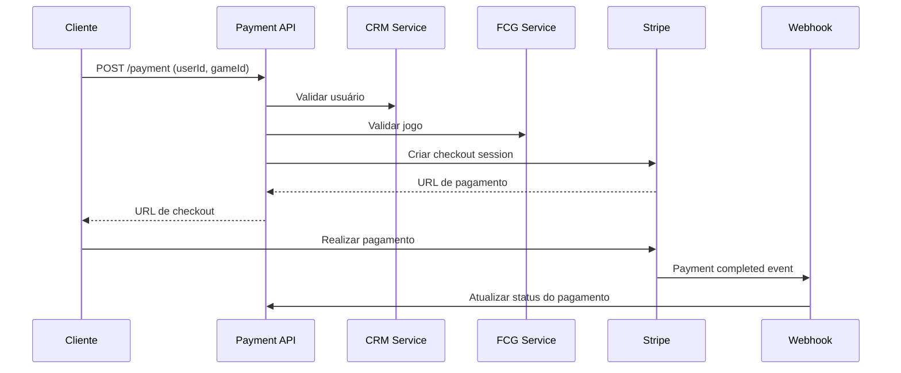

# 🕹️ FIAP Payment Service

> Sistema de pagamentos para compra de jogos digitais desenvolvido como projeto acadêmico da FIAP. Implementa arquitetura hexagonal, Domain-Driven Design (DDD) e integração com Stripe para processamento de pagamentos.

## 📋 Visão Geral do Projeto

Este projeto demonstra a implementação de um microserviço de pagamentos moderno seguindo as melhores práticas da indústria. O sistema processa compras de jogos digitais através de integração com o Stripe, validando usuários e produtos através de APIs externas (CRM e FCG).

### 🎯 Objetivos Educacionais

- **Clean Architecture**: Separação clara entre camadas de domínio, aplicação e infraestrutura
- **Domain-Driven Design (DDD)**: Modelagem rica de domínio com agregados e entidades
- **Arquitetura Hexagonal**: Inversão de dependências e isolamento do core business
- **Integração com APIs Externas**: Comunicação entre microserviços
- **Observabilidade**: Monitoramento com OpenTelemetry, logs estruturados e health checks
- **CI/CD**: Pipeline automatizado com GitHub Actions
- **Containerização**: Deploy em AWS ECS com Docker

## 🏗️ Arquitetura

### Estrutura de Camadas

```
├── 🎯 Core (Business Logic)
│   ├── Domain/          # Entidades, agregados e regras de negócio
│   └── Application/     # Casos de uso e serviços de aplicação
├── 🔌 Adapters
│   ├── Inbound/        # API Controllers (entrada)
│   └── Outbound/       # Repositories, HTTP clients (saída)
└── 🛠️ Cross-cutting
    ├── Common/         # Utilitários compartilhados
    ├── Contracts/      # Contratos de eventos
    └── IoC/           # Configuração de DI
```

### Fluxo de Pagamento



## 🚀 Como Executar

### Pré-requisitos

- .NET 8 SDK
- MySQL 8.0+
- Redis (opcional, para cache)
- Conta Stripe (modo teste)
- Stripe CLI (para webhooks locais)

### Configuração Local

1. **Clone o repositório**
```bash
git clone https://github.com/leandrokuranaga/fiap-payment.git
cd fiap-payment
```

2. **Configure as dependências**
```bash
dotnet restore Fiap.Payment.slnx
```

3. **Configure o Stripe**
```bash
# Instale o Stripe CLI
# https://docs.stripe.com/stripe-cli/install

# Configure webhooks locais
stripe listen --api-key sk_test_xxxx --forward-to https://localhost:7238/api/v1/webhook/stripe
```

4. **Execute a aplicação**
```bash
cd src/Fiap.Payment.Api
dotnet run
```

### Variáveis de Ambiente

Configure no `appsettings.Development.json` ou user secrets:

```json
{
  "ConnectionStrings": {
    "DefaultConnection": "Server=localhost;Database=FiapPayment;Uid=root;Pwd=password;"
  },
  "Stripe": {
    "PublishableKey": "pk_test_xxx",
    "SecretKey": "sk_test_xxx",
    "WebhookSecret": "whsec_xxx"
  },
  "ExternalServices": {
    "CRMUrl": "https://api-crm.exemplo.com",
    "FCGUrl": "https://api-fcg.exemplo.com"
  }
}
```

## 🔍 Endpoints da API

### Payment Controller

**POST** `/api/v1/payment`
- **Descrição**: Cria um pagamento para compra de jogo
- **Request Body**:
```json
{
  "userId": "1",
  "gameId": "6"
}
```
- **Response**:
```json
{
  "paymentId": "uuid",
  "checkoutUrl": "https://checkout.stripe.com/xxx",
  "expiresAt": "2024-01-01T10:00:00Z"
}
```

### Webhook Controller

**POST** `/api/v1/webhook/stripe`
- **Descrição**: Recebe eventos do Stripe
- **Headers**: `Stripe-Signature`

## 🧪 Testes

### Executar Testes
```bash
# Todos os testes
dotnet test Fiap.Payment.slnx --configuration Release --verbosity normal

# Projeto específico
dotnet test test/Fiap.Payment.Unit.Tests/Fiap.Payment.Unit.Tests.csproj
```

### Cobertura de Testes
```bash
dotnet test --collect:"XPlat Code Coverage"
```

### Estrutura de Testes

- **Unit Tests**: Testes unitários para domínio e aplicação
- **Integration Tests**: Testes de integração com banco e APIs
- **Contract Tests**: Validação de contratos de API

## 📊 Monitoramento e Observabilidade

### Logs Estruturados (Serilog)
- Console sink para desenvolvimento
- Grafana Loki para produção
- Correlação via correlation-id

### Distributed Tracing (OpenTelemetry)
- Jaeger para visualização de traces
- Instrumentação automática de HTTP calls
- Custom spans para operações de negócio

### Health Checks
- `/health`: Status da aplicação
- `/health/ready`: Readiness probe
- Verificação de conectividade com MySQL

### Métricas (Prometheus)
- Métricas de aplicação (.NET)
- Métricas customizadas de negócio
- Dashboard no Grafana

## 🚢 Deploy e CI/CD

### Build & Tests
| Pipeline | Status |
| --- | --- |
| Validação PR| [](https://github.com/leandrokuranaga/fiap-payment/actions/workflows/validate-release-pr.yml)
| Validação Main/Dev | [](https://github.com/leandrokuranaga/fiap-payment/actions/workflows/validate-pr.yml)
| Release | [](https://github.com/leandrokuranaga/fiap-payment/actions/workflows/release.yml)

### Deployment
| Ambiente | Status |
| --- | --- |
| Docker Hub | [](https://github.com/leandrokuranaga/fiap-payment/actions/workflows/deploy-dockerhub.yml) |
| AWS ECS | [](https://github.com/leandrokuranaga/fiap-payment/actions/workflows/deploy-aws.yml) |

### Estratégia de Branching
- **main**: Produção (releases)
- **dev**: Desenvolvimento (integração)
- **feature/***: Features em desenvolvimento
- **hotfix/***: Correções urgentes

## 💡 Conceitos Demonstrados

### 1. Domain-Driven Design (DDD)
- **Agregados**: `PaymentAggregate` encapsula regras de negócio
- **Value Objects**: Objetos imutáveis para representar conceitos
- **Domain Events**: Eventos de domínio para desacoplamento
- **Repositories**: Abstração para persistência

### 2. Clean Architecture
- **Independência de Framework**: Core não depende de tecnologias específicas
- **Testabilidade**: Fácil mockar dependências externas
- **Independência de UI**: API pode ser substituída por outras interfaces
- **Independência de Banco**: Repository pattern abstrai persistência

### 3. Patterns Implementados
- **CQRS**: Separação de comandos e consultas
- **Repository Pattern**: Abstração da camada de dados
- **Unit of Work**: Transações atômicas
- **Factory Pattern**: Criação de objetos complexos
- **Observer Pattern**: Domain events

### 4. Práticas de DevOps
- **Infrastructure as Code**: Docker e docker-compose
- **Automated Testing**: Testes em pipeline
- **Continuous Deployment**: Deploy automático em AWS
- **Monitoring**: Observabilidade completa

## 🔧 Tecnologias Utilizadas

### Backend
- **.NET 8**: Framework principal
- **ASP.NET Core**: Web API
- **Entity Framework Core**: ORM
- **FluentValidation**: Validação de dados
- **MediatR**: Mediator pattern

### Infraestrutura
- **MySQL**: Banco de dados principal
- **Redis**: Cache distribuído
- **Amazon SQS**: Message queue
- **Docker**: Containerização
- **AWS ECS**: Orquestração de containers

### Observabilidade
- **Serilog**: Logging estruturado
- **OpenTelemetry**: Distributed tracing
- **Prometheus**: Métricas
- **Grafana**: Dashboards
- **Jaeger**: Visualização de traces

### Testes
- **xUnit**: Framework de testes
- **Moq**: Mocking
- **Coverlet**: Code coverage
- **FluentAssertions**: Assertions fluentes

## 📝 Documentação Adicional

- [CLAUDE.md](./CLAUDE.md) - Guia para desenvolvimento com Claude Code
- [Swagger/OpenAPI](https://localhost:7238/swagger) - Documentação da API
